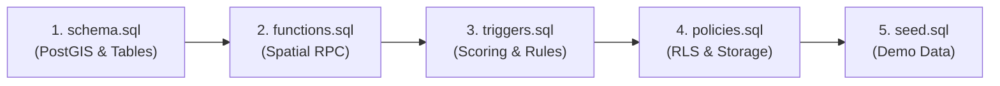

# Stage 10: Kukatpally Seed Dataset, Deployment Config & Final Verification

## 1. Executive Summary & Production Readiness

Stage 10 brings SafeRoute to complete production readiness. This stage delivers:
1. **Idempotent Kukatpally Seed Dataset (`supabase/seed.sql`)**: 20 realistic, spatially distributed road hazards across the Kukatpally Hyderabad corridor with complete relational integrity (demo accounts, profile roles, evidence photos, community verifications, comments, and municipal escalations).
2. **Cloud Deployment Descriptors (`render.yaml` & `Procfile`)**: Turnkey, secret-free deployment manifests for Render and Railway supporting Python 3.11.9, ASGI workers, and health check monitoring.
3. **Comprehensive Documentation & Runbook (`README.md` & `docs/`)**: Step-by-step setup, exact Supabase SQL migration sequence, and full demo walkthrough scenarios.
4. **End-to-End Verification**: Comprehensive test suite (`tests/test_stage10_seed_and_readiness.py`) validating SQL structures, deployment manifests, codebase security boundaries, and headless Chrome browser execution.

---

## 2. Final Architecture & Tech Stack Checklist

| Layer | Locked Technology | Verification Status | Notes |
|---|---|---|---|
| **Runtime & Backend** | Python 3.11.9, FastAPI | Passed | Async lifespan, modular router structure, Pydantic v2 schemas |
| **Templates** | Jinja2 | Passed | HTML5 templates extending `base.html`, double-submit CSRF tokens |
| **Frontend Dynamics** | HTMX + Alpine.js | Passed | Zero SPA build tools, declarative reactivity, safe `x-text` bindings |
| **CSS & Design** | Tailwind CSS CDN | Passed | SafeRoute design tokens, light-theme only, 0 `dark:` classes |
| **Database & Spatial** | Supabase PostgreSQL + PostGIS | Passed | PostGIS geography points, spatial GIST indexing, 100% RLS coverage |
| **Authentication** | Supabase Auth | Passed | HTTP-only session cookies, role verification (`user` vs `admin`) |
| **Photo Storage** | Supabase Storage (`hazard-photos`) | Passed | Authenticated bucket access, client & server-side EXIF stripping |
| **Mapping & GIS** | Leaflet.js + Leaflet.heat | Passed | Marker clustering, debounced bounds query, heatmap intensity |
| **Routing Engine** | OSRM Driving Service | Passed | 25m PostGIS buffer corridor scoring, deterministic demo fallback |
| **Civic Analytics** | Chart.js 4.4 | Passed | Responsive bar and doughnut charts with screen reader fallback tables |

---

## 3. Comprehensive Security Audit

A repository-wide security scan confirms adherence to all architectural constraints:

1. **Privileged Credential Guard**:
   - `SUPABASE_SERVICE_KEY` and the `service_role` secret are **NEVER** imported, referenced, or executed in application runtime code (`app/`).
   - All database interactions utilize `create_authenticated_supabase_client` scoped to the end-user's JWT session.
2. **Row-Level Security (RLS)**:
   - Enabled on all 7 tables (`profiles`, `hazard_reports`, `report_images`, `verifications`, `comments`, `escalations`, `status_history`).
   - Self-voting is prevented at both the database trigger layer (`trg_verifications_prevent_self_vote`) and application API layer.
   - Profile self-promotion to `admin` is blocked by database trigger `trg_profiles_prevent_role_escalation`.
3. **Privacy & EXIF Stripping**:
   - Live citizen geolocation is never tracked or persisted to database tables or browser storage.
   - Photos uploaded via `/reports/new` have all EXIF metadata stripped before storage in Supabase.
4. **XSS & DOM Injection Safety**:
   - Zero occurrences of `.innerHTML` or `dangerouslySetInnerHTML` across static JavaScript files.
   - Dynamic user-supplied text (descriptions, addresses, comments, authority notes) is rendered exclusively via Alpine `x-text` or escaped Jinja2 bindings.
5. **Color & Accessibility Compliance**:
   - No instances of `text-accent` (mint) on light surfaces.
   - Visible keyboard focus rings (`focus-visible:ring-2 focus-visible:ring-primary`).
   - Every Chart canvas is paired with an accessible fallback `<table>`.

---

## 4. Kukatpally Seed Dataset Inventory

The `supabase/seed.sql` script populates 20 realistic hazard reports across the Kukatpally corridor:

| ID | Category | Status | Address / Landmark | Lat, Lng | Notes |
|---|---|---|---|---|---|
| `b...0001` | `pothole` | `open` | Kukatpally Y Junction, NH65 | `17.48490, 78.41380` | High severity, 2 confirms, photo attached |
| `b...0002` | `pothole` | `open` | Kukatpally Y Junction, Flyover approach | `17.48498, 78.41392` | Duplicate candidate (< 16m from #1) |
| `b...0003` | `road_break` | `escalated` | Road No. 1, KPHB Colony | `17.49150, 78.40120` | Escalated to GHMC Kukatpally Circle |
| `b...0004` | `streetlight` | `open` | KPHB Colony Metro Station, NH65 | `17.49300, 78.39800` | 1 confirm, 1 dispute |
| `b...0005` | `footpath` | `escalated` | Opposite JNTU Gate 1, Pragathi Nagar Rd | `17.49750, 78.38880` | Escalated to HMDA / GHMC |
| `b...0006` | `other` | `open` | Balanagar Main Road, IDPL Colony | `17.46850, 78.44200` | Debris dumping blocking slip road |
| `b...0007` | `pothole` | `fixed` | Moosapet X Roads, Link Road | `17.47120, 78.42650` | 2 fixed votes, resolved in 72 hours |
| `b...0008` | `pothole` | `open` | Fatehnagar Flyover Service Road | `17.46210, 78.44850` | Stale report (created 40 days ago) |
| `b...0009` | `road_break` | `escalated` | KPHB Phase 3, Near Sujana Mall | `17.48800, 78.39050` | Escalated to Traffic Police (unbarricaded) |
| `b...0010` | `streetlight` | `escalated` | IDL Lake Road, Kukatpally | `17.48100, 78.40500` | Escalated to TSSPDCL (canal lighting) |
| `b...0011` | `footpath` | `open` | Sangeeth Nagar, Kukatpally Main Road | `17.48920, 78.41900` | Commercial hoarding blocking walkway |
| `b...0012` | `road_break` | `fixed` | HMT Hills Road, KPHB Colony | `17.50200, 78.39500` | 2 fixed votes, resolved in 96 hours |
| `b...0013` | `pothole` | `open` | Under Balanagar Flyover, Narsapur X Rd | `17.46780, 78.44620` | Clustered potholes |
| `b...0014` | `pothole` | `open` | Kukatpally Bus Depot Road | `17.48050, 78.42100` | Sharp rim-damage pothole |
| `b...0015` | `streetlight` | `escalated` | Pragathi Nagar Main Road | `17.50500, 78.38400` | Escalated to TSSPDCL (leaning pole) |
| `b...0016` | `footpath` | `fixed` | MIG Colony, KPHB 4th Phase | `17.49600, 78.40450` | 2 fixed votes, resolved in 48 hours |
| `b...0017` | `other` | `open` | Moosapet Anjaneya Nagar Colony Road | `17.47400, 78.43100` | Silted overflow drain |
| `b...0018` | `pothole` | `open` | JNTU Hi-Tech City Road, KPHB 7th Phase | `17.49000, 78.38200` | Wide shallow skid-risk depression |
| `b...0019` | `footpath` | `open` | Vivekananda Nagar, Kukatpally | `17.48700, 78.42450` | Broken kerb stones |
| `b...0020` | `road_break` | `open` | Bharat Nagar Flyover to Moosapet ramp | `17.46600, 78.43500` | Longitudinal expansion joint crack |

### Key Seed Metrics Summary:
- **Total Reports**: 20 (All with `is_seed = true`).
- **Category Representation**: Pothole (7), Road Break (4), Footpath (4), Streetlight (3), Other (2).
- **Status Representation**: Open (12), Escalated (5), Fixed (3).
- **Average Time to Fix**: $(72 + 96 + 48) / 3 = 72.0\text{ hours}$.
- **Idempotency**: 100% guarded via `ON CONFLICT DO NOTHING`.

---

## 5. Supabase SQL Migration Runbook

When deploying to a fresh Supabase project, execute the SQL files in the SQL Editor in this strict order:

1. **`supabase/schema.sql`**: Enables PostGIS, builds 7 tables, sets foreign keys, and indexes.
2. **`supabase/functions.sql`**: Deploys `reports_in_bounds`, `hazards_near_route`, `check_nearby_reports`.
3. **`supabase/triggers.sql`**: Installs severity formulas, self-vote guards, fixed threshold automation, and status history logs.
4. **`supabase/policies.sql`**: Activates RLS across all tables and configures `hazard-photos` storage policies.
5. **`supabase/seed.sql`**: Seeds demo accounts and the 20 Kukatpally hazard reports.

---

## 6. Cloud Deployment Guide (Render)

### Step 1: Link Repository
1. Log in to [Render](https://render.com).
2. Select **New** &rarr; **Blueprint**.
3. Connect `https://github.com/gowtham-32112/SafeRoute`.
4. Render automatically parses `render.yaml`.

### Step 2: Configure Environment Secrets
Fill in the following values in the Render Environment Variables pane:
- `SUPABASE_URL`: Your Supabase Project URL (`https://xyz.supabase.co`).
- `SUPABASE_ANON_KEY`: Public anonymous Supabase key.
- `VISION_API_KEY`: API key for Gemini Flash / Vision model.
- `SECRET_KEY`: Automatically generated by Render (`generateValue: true`).

### Step 3: Deploy & Monitor
- Build Command: `pip install -r requirements.txt`
- Start Command: `uvicorn app.main:app --host 0.0.0.0 --port $PORT`
- Health check URL: `/health`
- Render confirms healthy status when `{"status": "healthy", "application": "SafeRoute"}` returns 200.

---

## 7. End-to-End Demo Walkthrough Script

Use this script during live stakeholder presentations:

### Scene 1: Citizen Discovery on Live Map (`/map`)
1. Open [http://127.0.0.1:8000/map](http://127.0.0.1:8000/map).
2. Observe the map centered on Kukatpally Y Junction with 20 clustered markers.
3. Click category chips (`Potholes`, `Streetlights`, `Road Breaks`) to demonstrate instant client-side filtering.
4. Click a marker to inspect the popup showing severity badge, distance, and confirm/dispute counts.

### Scene 2: Submitting a New Hazard (`/reports/new`)
1. Navigate to `/reports/new`.
2. Observe the driving safety disclaimer: *"Never photograph hazards while driving or riding. Stop safely first."*
3. Upload a sample pothole image.
4. Watch Vision AI suggest `pothole` with high confidence.
5. Drag marker near Kukatpally Y Junction (`17.4849, 78.4138`).
6. Notice the instant duplicate warning modal prompting the user to confirm the existing report rather than duplicate.

### Scene 3: Community Peer Verification (`/reports/{id}`)
1. Open report detail view for `b0000000-0000-0000-0000-000000000001`.
2. Review the dynamic severity score breakdown (Base weight + Photo + AI + Confirms + Recency).
3. Cast a **Confirm** vote via HTMX — observe instant score recalculation without page reload.
4. Add a community comment: *"Waterlogged after rain, be careful."*

### Scene 4: Hazard-Aware Route Planning (`/routes`)
1. Navigate to `/routes`.
2. Click **Quick-Picks**: Origin: *Kukatpally Y Junction*, Destination: *KPHB Colony Metro*.
3. Click **Find Safest Route**.
4. Observe alternative routes color-coded by hazard risk. The system highlights the safest corridor taking hazard scores into account alongside travel time.

### Scene 5: Civic Safety Analytics & Heatmap (`/analytics`)
1. Navigate to `/analytics`.
2. Review the 5 KPI summary cards (Total Reports, Verification Rate, Duplicate Rate, Escalations, Avg Time to Fix).
3. View the Leaflet heatmap density across Kukatpally.
4. Toggle **"Exclude seed data"** — observe real-time recalculation filtering out synthetic demo records.

### Scene 6: Municipal Escalation Management (`/admin/escalations`)
1. Log in with admin credentials (`admin@saferoute.demo`).
2. Navigate to `/admin/escalations`.
3. Filter by high-severity recommended hazards.
4. Click **Escalate** on an unaddressed report, select authority `GHMC Kukatpally Circle`, and submit.
5. Observe the status transition to `escalated` and the report logged in the audit trail.
